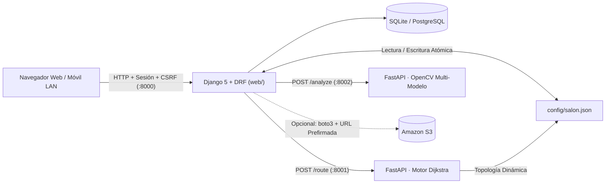

# Arquitectura y Organización del Proyecto — OptiFlow Dining

## 1. Visión General de Microservicios



## 2. Organización Limpia de Carpetas

```text
OptiFlow_Dining/
├── .agents/
│   └── AGENTS.md                  # Contexto técnico embebido del proyecto
├── .project-memory/               # Estado actual y bitácora de sesiones
├── config/
│   └── salon.json                 # Topología compartida (dimensiones, zonas, orígenes, mesas)
├── docs/
│   ├── ARQUITECTURA.md            # Especificación arquitectónica y de módulos
│   ├── guias/                     # Guías paso a paso de arranque (INICIAR_AQUI, COMANDOS_INICIO)
│   ├── preview/                   # Prototipo interactivo autónomo (vista_previa.*)
│   └── assets_archive/            # Respaldo histórico de bocetos e iconos preliminares
├── services/
│   ├── routing/                   # Microservicio FastAPI Dijkstra (:8001) + pruebas unitarias
│   └── vision/                    # Microservicio FastAPI OpenCV (:8002)
├── web/
│   ├── manage.py
│   ├── optiflow/                  # Settings, seguridad de red LAN, URLs raíz y WSGI
│   ├── core/
│   │   ├── layout.py              # Motor CAD espacial, límites estrictos y partición zonal
│   │   ├── models.py              # Entidades operativas y notificaciones por destinatario
│   │   ├── serializers.py         # Validación de contratos REST DRF
│   │   ├── services.py            # Clientes HTTP internos y conector AWS S3
│   │   ├── views/                 # Paquete modularizado de vistas y APIs (<300 líneas c/u)
│   │   │   ├── helpers.py         # Decoradores de rol, contexto transversal y red LAN
│   │   │   ├── auth_profile.py    # Autenticación, perfil, avisos y gestión de roles
│   │   │   ├── pages.py           # Vistas HTML de los 6 módulos operativos
│   │   │   ├── api_routing.py     # APIs de rutas, cierre de asignaciones y saturación
│   │   │   └── api_cad_vision.py  # APIs CAD de mesas/dimensiones y visión OpenCV
│   │   └── tests.py               # Suite integral de 26 pruebas automatizadas
│   ├── templates/                 # Plantillas Django desacopladas
│   └── static/
│       ├── css/app.css            # Sistema de diseño Dark Hospitality
│       ├── img/                   # Solo los 5 activos gráficos de producción en uso
│       └── js/
│           ├── app.js             # Punto de entrada ligero (bootstrap)
│           └── modules/           # Módulos JS por dominio (core, floor_plan, routing, cad_tables, vision_zones)
├── iniciar.cmd                    # Lanzador Windows CMD (1 clic)
├── iniciar.ps1                    # Lanzador Windows PowerShell
└── docker-compose.yml             # Orquestación de contenedores
```

## 3. Reglas Espaciales y Operativas Clave

1. **Muro Estricto de Dimensiones (`columns × rows`):**
   - El plano SVG escala su `viewBox`, pasillos y sectores `A / B / C` dinámicamente según `salon.json`.
   - Toda coordenada fuera de `0..columns-1` o `0..rows-1` es rechazada tanto al crear/mover mesas como en el motor Dijkstra.
2. **Coherencia Física `Zona ↔ Coordenada`:**
   - Reasignar una mesa a otra zona la traslada automáticamente a una celda libre de las columnas de esa zona; si el sector está lleno dentro de las dimensiones actuales, retorna alerta `HTTP 400`.
3. **Ciclo Completo de Tareas Asignadas:**
   - El botón `Atender ➔` traza el recorrido guardado (`data-path`) sin duplicar registros en base de datos.
   - Al pulsar `Finalizar tarea`, se retira la alerta del mesero en tiempo real, el estado pasa a `Finalizada` y se emite un `AdminNotification` directo al supervisor (`capitan`, `gerente` o `admin`) que despachó el servicio.

